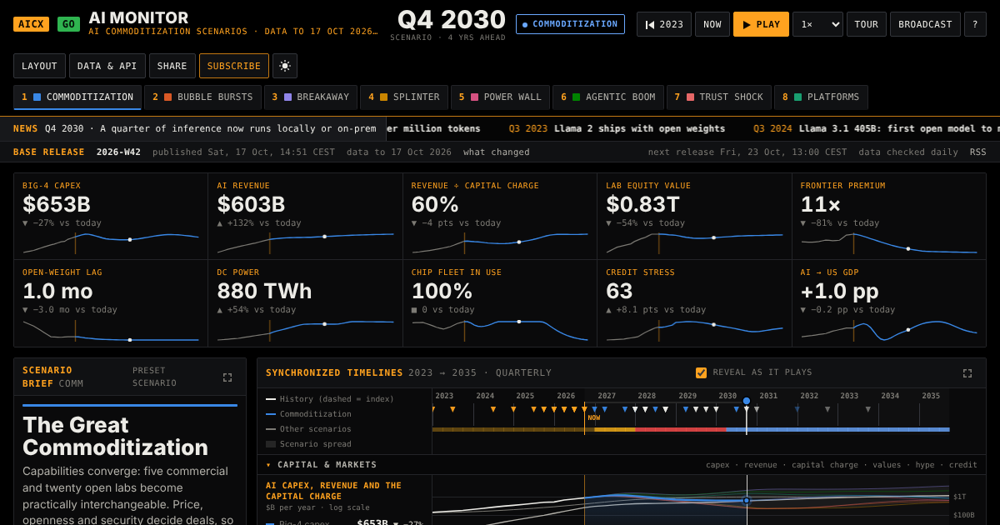

# AI Forecast Atlas

**A weekly-updated scenario monitor of AI commoditization** — capex, revenue, token prices, compute, energy, market structure and work, quarterly from 2023 to 2035 in eight scenarios — with open data, a newsletter, an AI assistant and an MCP server for other AI tools.

Live: **https://aiforecastatlas.com** · by [Creoox AG](https://creoox.com), the team behind [xeokit SDK](https://xeokit.io).



## What it does

- **Dashboard** — synchronized timelines, causal map, phase portrait, value migration, sector lens (AECO, AECO software, software development), impact matrix, early-warning signposts and a sourced evidence ledger. Dark and light themes; every panel can be expanded, resized, pinned, moved or hidden, with presets and "Reset to default".
- **Guidance and trust** — a short guided tour, an explainer for every panel and tab (what it shows, how to read it, why it matters, the method and its caveats), glossary tooltips, and a source card behind every number: for data, the original source with link, quote and review date; for model results, the formula and its inputs. Knowledge that AI models hold without a citable page is welcome too, always labelled "AI knowledge" with the model and date. A "Sources & methods" view lists everything in one place.
- **Weekly releases** — every day official sources (SEC EDGAR, EIA, OpenRouter, Epoch AI) and an **AI research panel** feed a review queue. The panel asks five AI agents (OpenAI, Anthropic Claude, Google Gemini, xAI Grok, DeepSeek) the same question; each answer must quote its source page or be marked as the model's own knowledge, and the answers are combined by weighted median with weights the editor sets. A value is approved only with its source link (or the "AI knowledge" label) and keeps its provenance, including every agent's answer, in the public data. Approved values re-anchor the model; every **Friday at 13:00 Central European time** a release recomputes all scenarios and publishes data files, charts and feeds.
- **X watch** — Grok scans X every weekday for posts that matter to the monitor, from credible accounts and accounts with heavy impact on X, labelled for credibility and impact. The editor approves each item; approved items appear on the dashboard, in the release, the feeds and the newsletter. Signals, not data.
- **Newsletter** — double opt-in sign-up with topics, language (EN/DE/FR/PL) and frequency; one email per subscriber built from the release; one-click unsubscribe; no tracking. Sent with Mailjet.
- **AI assistant** — visitors ask about what they see ("what does this mean for an AECO firm?" or "explain this panel") and can send improvement ideas to the team. Answers cite the evidence ledger and the model formulas with clickable references. Works with OpenAI, Anthropic, Google Gemini, xAI, DeepSeek, Mistral, Perplexity or OpenRouter.
- **Open data** — JSON/CSV per release, a Frictionless data package, chart images (SVG), RSS/Atom/JSON Feed, an iCalendar of releases, embeddable charts, `llms.txt`, an OpenAPI description and a read-only **MCP server**. Data under CC BY 4.0.

## Runs on plain PHP hosting

No database, no Node.js on the server: static files plus PHP 8.0+ (tested with PHP 8.0, 8.2 and 8.3; written for home.pl's 8.2). The model runs in the browser; the weekly release is computed in the admin's browser (or by the optional GitHub Action) with the same code.

**Install on home.pl:** follow [docs/INSTALL-HOMEPL.md](docs/INSTALL-HOMEPL.md) — subdomain, SSL, upload, keys, scheduler, Mailjet.

## Develop

```bash
node web/build.mjs          # → dist/homepl/aimonitor, dist/homepl/cron, dist/artifact/ai-monitor.html, zips
npm test                    # unit tests (Node 20+)
node test/integration.mjs   # end-to-end with PHP's built-in server and mocked services (needs PHP 8 CLI)
python3 test/ui/ui_test.py  # browser test with Playwright (optional)
php -S 127.0.0.1:8080 -t dist/homepl/aimonitor   # run locally
```

No npm dependencies. Project layout:

| Path | Contents |
|---|---|
| `engine/engine.mjs` | the scenario model (system dynamics, quarterly, 8 scenarios, 14 drivers) |
| `web/src/` | dashboard (`template.html`, `app.js`), site layer (`site.js`), release builder (`release-core.mjs`), chart embed |
| `server/web/` | PHP endpoints (`api/`), admin page, privacy notice, imprint, server check |
| `server/_private/` | PHP library, scheduler, configuration; `storage/` holds settings and data at run time |
| `config/` | newsletter topics and languages, translations, data-source settings, `methods.json` (panel explainers, measure definitions and formulas, history sources, glossary) |
| `tools/release.mjs` | build and stage a release from a computer or CI |
| `docs/` | installation, architecture, data API, automation, licensing, legal checklist, roadmap |

## Licences

- **Code, model and design:** Business Source License 1.1 — see [LICENSE](LICENSE). The source is public: you may read, study, change and run it, and use it in production — but not to offer a competing AI forecast, scenario or monitoring service. Each version becomes GNU AGPL-3.0 four years after its release. Commercial licences: contact@creoox.com.
- **Published data and charts:** Creative Commons Attribution 4.0 — see [LICENSE-DATA.md](LICENSE-DATA.md). Credit “AI Forecast Atlas by Creoox AG” and the release.
- See [docs/LICENSING.md](docs/LICENSING.md) for what this means in practice.
- Third-party data keep their own terms (SEC EDGAR: public; EIA: public domain; Epoch AI: CC BY 4.0).
- **Trademarks** are not licensed. All company and product names are trademarks™ or registered® trademarks of their holders; their use implies no affiliation or endorsement. Autodesk is a registered trademark of Autodesk, Inc.; Creoox AG is not affiliated with Autodesk, Inc.

A scenario model, not a forecast and not investment advice.
